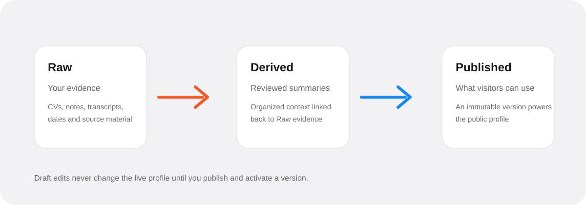

TLDT reuses reviewed career evidence across job discovery, preparation, and optional public representation. Each workflow answers a different question; useful answers can return to Memory through a review step.

## One career workflow

**CV and existing context → reviewed Memory → Search Profile → Job Search and Instant Fit → Fast Check → Simulate → Memory Gaps → your answers → reviewed Memory changes.**

Repeat the cycle for the next role. Test and share the public twin when you want someone else to explore the context you have published. The [quickstart](/quickstart) turns this sequence into a first-use walkthrough.

## What each part does

| Part | What it helps you do | Evidence it uses |
| --- | --- | --- |
| [Profile](/profile) | Add a CV and prepare your private Search Profile. | Active published CV and selected published Derived Memory. |
| [Job Search](/jobs/search) | Find roles, filter them, and keep useful vacancies. | External vacancy catalogue and your search choices. |
| [Instant Fit](/jobs/instant-fit) | Prioritize roles worth reading more closely. | Vacancy plus the CV and Memory selection saved with Search Profile. |
| [Fast Check](/public-profile/fast-check) | Inspect detailed fit, mismatches, and missing proof for one role. | The published Memory version captured for the check. |
| [Auto Simulate](/owner-review/simulate) | Test how your twin answers interview questions. | The published Memory version pinned to the session. |
| [Manual Simulate](/owner-review/simulate) | Rehearse your own answers. | The vacancy, interview context, and what you explicitly say. |
| [Memory Gaps](/memory/gaps) | Find questions that published evidence does not explain well. | An analyzed Memory version or the original Fast Check/Simulate context. |
| [Memory Loop](/memory/loop) | Propose additions from saved owner answers. | Selected answers and related Derived documents in the active draft. |
| [Preview](/owner-review/preview) | Test public-style answers before sharing. | Active published Memory. |
| [Public Chat and CV](/public-profile/overview) | Let visitors explore approved context. | Active published Memory and your public settings. |
| [Saved shares](/sharing) | Share a stable view of one completed result. | The visitor-safe snapshot you choose to share. |

A simulation created without published Memory remains Manual-only and cannot later analyze Memory gaps from that session.

## Keep the states distinct

<Frame caption="Review and publication control which evidence becomes active">
  
</Frame>

| State | What it contains | When it affects the twin |
| --- | --- | --- |
| Raw | Original or extracted evidence such as notes, documents, and saved answers. | Only eligible Public documents included in the published version can be used by the public runtime. |
| Derived | Organized career context and representation guidance. | Reviewed Public documents become available through publication. |
| Draft | Your editable Raw and Derived documents. | Draft edits alone never change active answers. |
| Gap answer or Review proposal | Saved testimony or a proposed Memory change. | A proposal must be accepted into the draft, then published. |
| Published version | A fixed snapshot of the reviewed Public draft. | Active workflows use it; existing pinned sessions keep their original version. |

**Public** on a draft document means eligible for publication. **Private** excludes it from published runtime Memory. Raw sources can remain Private while an owner-reviewed Derived explanation is published.

The Memory workspace's **Publish** action creates and activates a version. The **Public link** switch separately controls whether visitors can open your profile. You can keep that link disabled while using published Memory for private search and preparation.

## What improves your Memory

Gap analysis can follow a completed check or simulation. It does not change your documents. You supply an answer, start generation, review the proposal, accept it into the draft, and publish when ready.

Saving an entire session to Raw Memory preserves a source. It is separate from Memory Loop and does not automatically turn visitor statements or Auto answers into your professional history.

## Keep decisions with people

TLDT can explain evidence, identify unknowns, and support a visible meeting-booking flow. Fit categories and simulation reports are preparation aids. They are not hiring predictions, proof of interest, or permission for the twin to apply, negotiate, or accept a role on your behalf.
